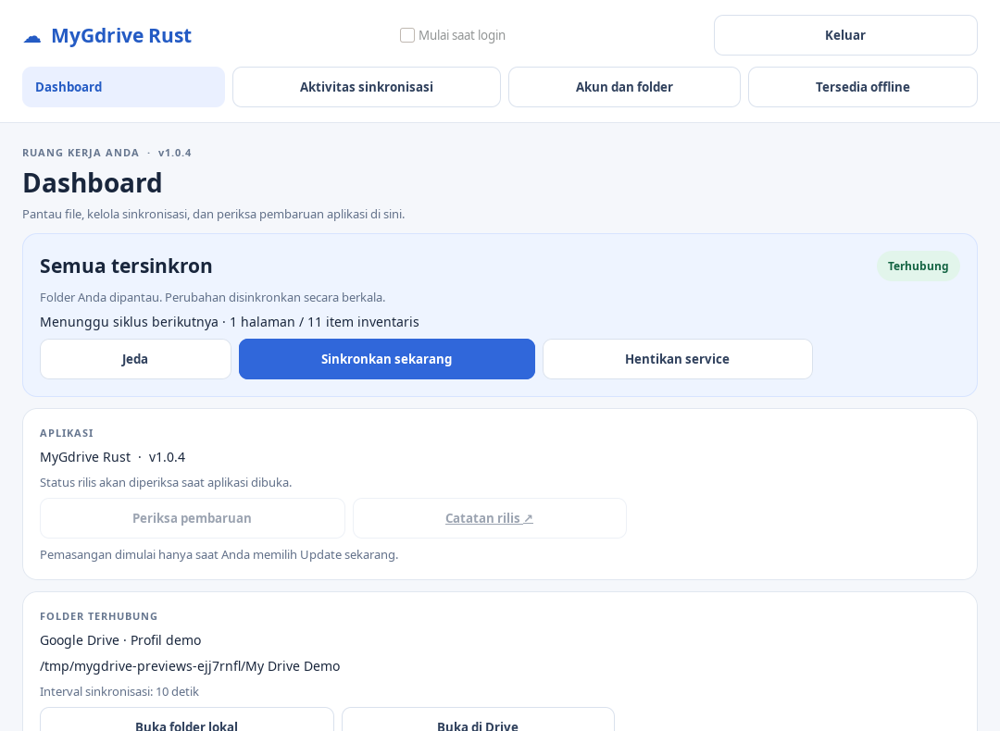
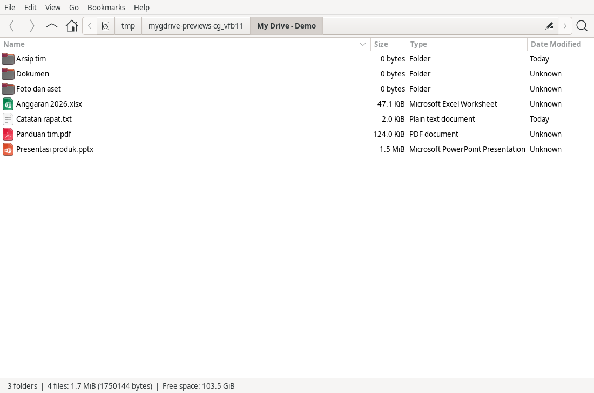
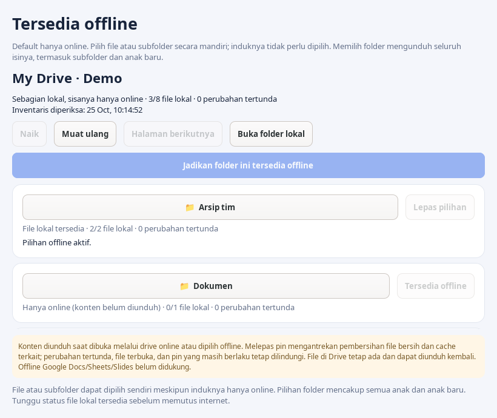
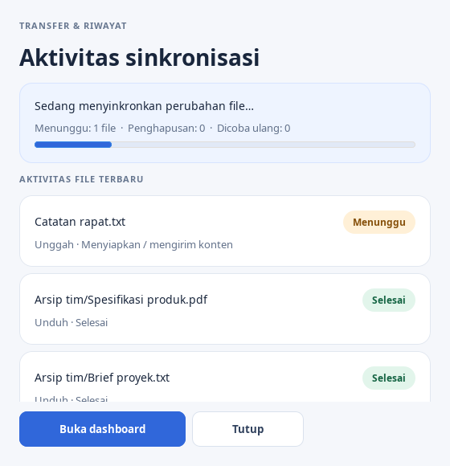

# MyGdrive Rust

Google Drive synchronization for Linux, written in Rust. Browse My Drive from the desktop and file manager, download content when needed, and select files or folders to keep available offline.

**Latest release: [v1.0.5](https://github.com/mhdr1zky/MyGdrive-Rust/releases/tag/v1.0.5)** — amd64 `.deb` packages for Ubuntu 24.04/Linux Mint 22 and x86_64 AppImage. This is an independent project and is not affiliated with Google.

The dashboard displays the running version and checks GitHub releases periodically. Package downloads and installation require **Update now** and SHA-256 verification. See the [changelog](CHANGELOG.md).

## Application preview

Screenshots use example profiles and files on Linux. The Thunar virtual drive comes from the native package; package differences are listed below. Existing screenshots may show the Indonesian interface.

| Sync dashboard | Online drive in Thunar |
| --- | --- |
|  |  |
| **Available offline selections** | **Sync activity details** |
|  |  |

## Features

- Two-way upload, download, rename, move, and Trash with server change checks.
- Metadata-only by default. Content downloads when opened through the online mount or selected for offline access.
- Recursive offline selections, including future children, with independent file/subfolder pins.
- Office owner files (`~$…`), LibreOffice locks (`.~lock.…#`), and known Word scratch patterns do not enter new sync queues. Temporary-file-and-rename saves remain supported.
- Preserve-both content conflicts; some recovery cases wait for review before uploading.
- Dashboard, tray, queue, activity history, pause/resume, and manual sync. Notifications do not automatically open the activity window; **View details** opens it.
- Separate account/Drive-folder/local-folder profiles with independent state.
- Linux FUSE mount, Thunar context actions and folder badges, and optional autostart per profile.
- Persistent SQLite WAL queues, content checksums, restart recovery, and cache cleanup that protects offline files and local changes.
- Missing unpublished temporary files complete locally after active upload and recovery journals have been checked.
- File-based English, Indonesian, and Simplified Chinese interface translations, selected from the system locale by default.

## Interface language

The default is `auto`. Locale precedence is `LC_ALL`, `LC_MESSAGES`, then `LANG`; GNU `LANGUAGE` preferences are honored outside the C/POSIX locale. Regional variants such as `en_US.UTF-8`, `id_ID`, and `zh-CN` resolve to `en`, `id`, and `zh`. Unsupported languages fall back to English.

```bash
./run-desktop.sh --language auto
./run-desktop.sh --language en
./run-desktop.sh --language id
./run-desktop.sh --language zh
MYGDRIVE_LANGUAGE=id ./run-desktop.sh
```

Translations live in [`assets/locales/`](assets/locales/): `en.json`, `id.json`, and `zh.json`. Runtime overrides load from the installed catalog directory, then `$XDG_CONFIG_HOME/mygdrive/locales` (normally `~/.config/mygdrive/locales`), then `MYGDRIVE_LOCALES_DIR`. Catalogs are read when a process starts; restart the application after editing them. A running profile reuses its current process and language. See [the translation guide](docs/LOCALIZATION.md) for custom languages, placeholders, and fallback behavior. Repository documentation is maintained in English.

## Choose a package

| Feature | `.deb` | AppImage |
| --- | --- | --- |
| Dashboard, tray, OAuth login, local folder sync | Yes | Yes |
| File/subfolder offline selections and unpin | Yes | Yes |
| FUSE virtual drive helper | Yes | Yes, through `--mount` |
| Thunar menus and badges | Native setup | Manual setup; use `.deb` for full integration |
| Start at login | Optional | Optional; keep the AppImage at a fixed location |

## Run the AppImage

Download `mygdrive-rust_1.0.5_x86_64.AppImage` from [release v1.0.5](https://github.com/mhdr1zky/MyGdrive-Rust/releases/tag/v1.0.5):

```bash
chmod +x mygdrive-rust_1.0.5_x86_64.AppImage
./mygdrive-rust_1.0.5_x86_64.AppImage
# CLI and virtual drive helper:
./mygdrive-rust_1.0.5_x86_64.AppImage --sync --help
./mygdrive-rust_1.0.5_x86_64.AppImage --mount --help
```

The x86_64 AppImage targets Ubuntu 24.04/Linux Mint 22 or systems with glibc 2.39+. GTK libraries are bundled; graphics drivers, fonts, browser, and desktop services come from the host. It is not a sandbox. State and tokens use the native location (`~/.local/share/mygdrive/`); do not run `.deb` and AppImage processes against the same profile simultaneously.

If the AppImage runtime cannot mount, use `--appimage-extract-and-run`. The application's virtual drive separately requires host FUSE support and `/dev/fuse` permissions. The AppImage does not automatically install Thunar actions or start an online mount. For a manual mount, use `--mount --state /path/profile --mount /path/mount` with an empty mount directory. The `.deb` provides managed mount launchers and Thunar integration.

Keep the AppImage at a fixed location before enabling **Start at login**. **Update now** replaces it at that location. For a manual update, quit the application and profile service, then replace the file with the new version at the same path. See the [AppImage user guide](https://docs.appimage.org/user-guide/run-appimages.html).

## Install the Debian package

Download `mygdrive-rust_1.0.5_amd64.deb` from the repository's Releases page:

```bash
sudo apt install ./mygdrive-rust_1.0.5_amd64.deb
/usr/bin/mygdrive-desktop
```

`apt` installs runtime dependencies. Rust and a compiler are not required to run the package. Version 1 targets amd64 Linux; ARM, Windows, macOS, and Debian 12 are not package targets.

When upgrading from v1.0.0–v1.0.4, use **Quit** to drain active operations before installing. Local folders, accounts, and offline selections are retained. Upgrading v1.0.0 migrates schema 3 to 4; v1.0.0 cannot read migrated state. Version 1.0.1 already uses schema 4. Keep a state backup if a downgrade may be necessary.

An older source launcher at `~/.local/share/applications/io.mygdrive.Desktop.desktop` can take precedence over the package launcher. Archive that entry to use the package from the application menu. `/usr/bin/mygdrive-desktop` always opens the packaged version. Adjust paths if `$XDG_DATA_HOME` is set.

| Command | Purpose |
| --- | --- |
| `mygdrive-desktop` | GTK4 dashboard and tray |
| `mygdrive-sync` | Login, sync, status, and service controls |
| `mygdrive-mount` | FUSE online mount for a configured profile |

## GitHub updates

Builds with the updater check the latest stable release in `mhdr1zky/MyGdrive-Rust` when the dashboard opens, then every six hours while the dashboard/tray runs. Checks use the [GitHub Releases API](https://docs.github.com/en/rest/releases/releases#get-the-latest-release) without a GitHub token. Drafts, prereleases, equal versions, and older versions are not installed. Connection failures retry after 30 minutes.

The **Application** card shows the running version, check/download/install status, and failures. **Check for updates** requests a fresh check. **Update now** appears when a newer release has matching package assets. Periodic checks read metadata only; downloading and installation require a click, with no deadline for deciding. **Release notes** opens GitHub. If the release changes before installation, select the update again.

- AppImage updates require host `python3` and write access to the AppImage and its directory. Staging uses the same filesystem, verifies the release's `SHA256SUMS`, and atomically replaces the original. Interrupted or invalid downloads leave the old file intact.
- `.deb` updates verify the checksum, package name, version, and architecture. `pkexec` requests administrator authentication and runs `apt-get --yes --no-remove install` on the verified package. Passwords are not stored. Authentication rejection or installation failure is reported; a later installation still requires a new user action. `install.log` is stored beside the updater status file.
- Reopen the application and profile service to use the new version. The updater does not forcibly stop active sync or restart services. Profiles share a lock per installation location.

Version 1.0.2 and earlier require a one-time manual upgrade to a package containing the updater. Source/development builds check versions but open the release page for manual installation. Standalone CLI and mount processes do not check for updates.

Set `MYGDRIVE_DISABLE_AUTO_UPDATE=1` in the dashboard environment, including its launcher/autostart if used, to disable checks. Status and scheduling live in `~/.local/share/mygdrive/updates/INSTALLATION_ID/status.json`, following `$XDG_DATA_HOME`. Only the workflow's Linux x86_64/amd64 packages are supported. Publish all package assets and `SHA256SUMS` together; the release workflow generates both.

## Get started

1. Create a Google OAuth **Desktop app** client and download its JSON. Follow [OAuth setup](OAUTH_SETUP.md); shared credentials are not bundled.
2. Open **MyGdrive Rust → Accounts and folders → Connect a new account…**, select the client JSON, and complete browser sign-in.
3. Choose **My Drive** or a subfolder, then an empty local folder separate from application state.
4. Save the pair, open its profile dashboard, and start the service to inventory and sync.
5. Use **Available offline** to select content to retain. Files and subfolders can be selected independently of their parents. Folder selections include future children. Wait for downloads to complete before disconnecting.

If a selection is saved but content is missing, check that the same profile's service is running, unpaused, and connected. **Resume** starts pending downloads; selecting the parent is unnecessary.

Unpin queues cleanup after the next successful online, unpaused cycle. Clean synchronized files and related cache are removed locally; pending changes, open files, and remaining pins are protected. Drive files are not deleted. Metadata stays visible through the online mount; reopening downloads content again.

### Online mount and Thunar

Dashboard profiles live in `~/.local/share/mygdrive/profiles/PROFILE_ID/`. Match `root` in `service-config.json` to the chosen local folder. Replace `PROFILE_ID` below and use the configured account label. Adjust for `$XDG_DATA_HOME` when set.

```bash
python3 /usr/lib/mygdrive-rust/scripts/configure-online-drive.py \
  --state "$HOME/.local/share/mygdrive/profiles/PROFILE_ID" \
  --account default --mount "$HOME/MyGDrive-Online"
mygdrive-desktop --state "$HOME/.local/share/mygdrive/profiles/PROFILE_ID"

python3 /usr/lib/mygdrive-rust/scripts/install-thunar-actions.py \
  --state "$HOME/.local/share/mygdrive/profiles/PROFILE_ID" \
  --account default --mount "$HOME/MyGDrive-Online"
```

The mount must be empty, owned by the user, and outside the local folder and state directory. The desktop launcher starts a configured mount. The profile service must run for on-demand downloads. Run installers as a normal user. The Thunar installer preserves unrelated actions and backs up the previous configuration. Integration is optional. **Start at login** enables autostart for the current profile.

## CLI usage

This example creates a separate CLI pair. `DRIVE_FOLDER_ID` is a Google Drive folder ID; `root` means My Drive. Keep the same state, account, local root, and Drive folder for the pair.

```bash
mkdir -p "$HOME/MyGDrive"
# Browser login; the client JSON is not an access token.
mygdrive-sync --state "$HOME/.local/share/mygdrive-cli" --account default \
  login --client-json "$HOME/Downloads/oauth-client.json" --scope drive
# One sync cycle.
mygdrive-sync --state "$HOME/.local/share/mygdrive-cli" --account default \
  --root "$HOME/MyGDrive" --drive-folder DRIVE_FOLDER_ID sync
# Continuous watcher and cloud polling.
mygdrive-sync --state "$HOME/.local/share/mygdrive-cli" --account default \
  --root "$HOME/MyGDrive" --drive-folder DRIVE_FOLDER_ID run --interval 10
```

New profiles use a 10-second cloud interval; saved intervals remain unless overridden. Local watcher changes wake the scheduler without waiting for cloud polling. Up to four routine metadata GETs can overlap; background content transfers remain sequential.

Control a running service from another terminal:

```bash
mygdrive-sync --state "$HOME/.local/share/mygdrive-cli" service status
mygdrive-sync --state "$HOME/.local/share/mygdrive-cli" service pause
mygdrive-sync --state "$HOME/.local/share/mygdrive-cli" service resume
mygdrive-sync --state "$HOME/.local/share/mygdrive-cli" service sync-now
mygdrive-sync --state "$HOME/.local/share/mygdrive-cli" service shutdown
```

`scan` and `status` can run without Google Drive access. State-writing CLI commands such as `scan`, `sync`, `pin`, and `cache-prune` require the daemon's writer lock; stop it first or use GUI/IPC controls. See `mygdrive-sync --help`.

A mock fixture with 24 files and 40 ms metadata latency measured 1,150 → 360 ms (about 3.2× faster), with identical GET counts and no repeated content downloads. This is not a real Google Drive speed guarantee. See [measurement conditions](docs/PERFORMANCE.md).

## Local data and account access

Default state is `~/.local/share/mygdrive`, following `$XDG_DATA_HOME`. Dashboard profiles use `profiles/`. State contains configuration, SQLite, cache, upload queues, and OAuth tokens; the local content folder is separate.

Login uses the system browser, PKCE, state validation, and a loopback callback. OAuth directories/files use `0700`/`0600`, but tokens are not OS-keyring encrypted. Keep client JSON and state private.

The `drive` scope allows reading and managing accessible Drive files. Choosing a subfolder limits application behavior, not OAuth permissions. `drive-file` is narrower and does not automatically cover existing files; Google Picker is not integrated. See [Google's scope documentation](https://developers.google.com/workspace/drive/api/guides/api-specific-auth).

## Version 1.0.5 limits

- My Drive and ordinary Office, PDF, image, text, and archive files are supported. Native Google Docs/Sheets/Slides content sync and round trips are not.
- Shared Drives and a complete Shared with me view are unavailable.
- Each state binds one account/local-folder/Drive-folder pair. Profiles can run separately; there is no all-profile supervisor.
- Unpin cleanup waits for successful sync and retains dirty, pending, review-required, open, or effectively pinned files.
- Interrupted downloads restart from the beginning; Range resume is unavailable.
- The scanner rejects symlinks, hardlinks, non-UTF-8 paths, and special files.
- Metadata conflicts, delete-versus-edit, and some recovery states require review. Folder Trash uses checks and compensating restore, not an atomic Drive transaction.
- Large initial inventories can take time. Tray and badge availability depend on the desktop/file manager.

## Comparison with Google Drive for desktop

The repository's comparison was recorded on 25 October 2026 using Google's documentation. MyGdrive Rust is a Linux client; Google's desktop application targets Windows and macOS. This is not a claim of feature parity.

| Behavior | Google Drive for desktop | MyGdrive Rust |
| --- | --- | --- |
| Metadata browsing | Streaming virtual drive; content fetched as needed ([stream/mirror](https://support.google.com/drive/answer/13401938?hl=en)) | Metadata by default; FUSE mount with separate setup |
| Offline file/subfolder selection | Independent selections, including future folder children ([offline access](https://support.google.com/drive/answer/2375012?hl=en)) | Independent recursive pins; downloads require a running, unpaused service |
| Streaming disk usage | Managed cache and offline-files view ([cache settings](https://support.google.com/drive/answer/13470231?hl=en)) | Unpin cleanup; optional cache budget, no unified disk-usage view or automatic eviction of all opened local copies |
| Mirror My Drive | User-facing stream/mirror switch | Internal legacy mirror mode; no supported dashboard mode migration |
| Shared Drives | Streaming support | My Drive/subfolders only |
| Multiple accounts | Up to four concurrent accounts ([account settings](https://support.google.com/drive/answer/13470231?hl=en)) | Separate profiles; no unified supervisor |
| Google Workspace documents | Separate browser/offline integration | No native offline round-trip implementation |

See the [detailed audit](AUDIT_GOOGLE_DRIVE_DESKTOP.md) for remaining product and efficiency gaps.

## Build and development

```bash
cargo test --locked
./build-desktop.sh --locked
./run-desktop.sh
```

GTK development packages are required for desktop builds. The build script detects `.tools/gtk-sdk` and `.tools/cargo` when present. Core/CLI builds do not require GTK. See [desktop development](DESKTOP.md), [service IPC](SERVICE.md), [offline behavior](OFFLINE_MODE.md), [Thunar/FUSE](THUNAR_ONLINE.md), [scope migration](STREAM_MY_DRIVE.md), [mutations](SYNC_MUTATIONS.md), and [performance notes](PERFORMANCE.md).

Build distribution packages with `scripts/build-deb.sh` and `scripts/build-appimage.sh`. Release automation is in `.github/workflows/release.yml`. Keep credentials, state databases, `.tools`, build output, and local test artifacts out of published source. The project is licensed under [MIT](LICENSE).
