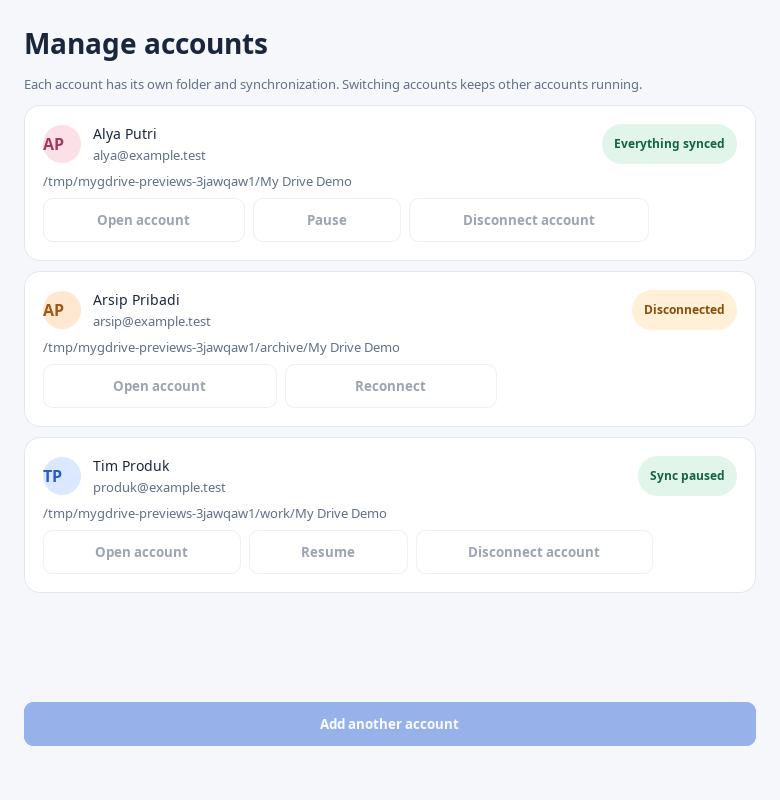

# Multi-account desktop

Available from v1.1.0. Open the avatar/email menu at the top right of the dashboard, or choose **Manage accounts**. The menu lists the identity, current selection and sync status for every account in the current collection.



## Add and switch accounts

Choose **Add another account**, complete Google sign-in in the browser, then select that account's Drive folder and a separate local folder. The first connection needs your Google Desktop OAuth client JSON; later accounts can reuse its application registration. Access tokens, refresh tokens, Google user bindings, SQLite state and local folders remain separate. A cancelled, unauthenticated draft is excluded from the account list.

Select an account to replace the contents of the same dashboard window. Other account services keep syncing. **Manage accounts** shows each local folder and allows independent start, pause/resume, reconnect and disconnect. A paused account stays paused when you switch away or restart it. Account switching waits for an in-progress desktop action to finish.

The application groups the legacy base profile and direct profiles under `<base>/profiles/`. Launching a profile in that collection forwards to its existing desktop application; a background autostart request starts its own profile without switching the visible account. Separate, unrelated state directories remain separate collections.

```sh
mygdrive-desktop --state /path/to/collection --accounts
```

## Disconnect and reconnect

Choose **Disconnect account** and confirm the selected email. The application requests a graceful shutdown and waits for that profile's writer lock before removing local login tokens and disabling its login autostart entry. If shutdown cannot be confirmed, credentials stay in place. Local files, pending journals, recovery copies, cloud files and other accounts are retained. This does not revoke the Google application's grant, which could affect other profiles using that registration.

A disconnected account remains listed so its original folder reservation and identity are visible. Choose **Reconnect**, then **Sign in again to selected account**, and use the same Google account. The retained permission ID prevents a different Google user from taking over existing profile state. To connect a different user, use **Add another account** and a separate folder.

## Quit and updates

The global **Quit** action drains all account services in the collection. Closing the dashboard keeps the existing tray behavior. Before a packaged update restarts the desktop, a private restart receipt records all running profiles. The new process restores that set without resetting persisted pause state. An unresponsive service blocks the drain; an interrupted attempt retains its receipt for retry. Existing FUSE mounts remain mounted to protect open file handles.

## Comparison with Google Drive for desktop

Google's [account settings](https://support.google.com/drive/answer/13470231?hl=en) document adding multiple accounts, disconnecting individual accounts and up to four simultaneous accounts. MyGdrive follows the familiar avatar menu, account identities, selected-account checkmark, add-account action and account preferences. It uses a Linux GTK interface and independent profile services; it does not implement Google's proprietary virtual-volume or account-management backend. This release does not impose Google's four-account limit, although large account collections consume additional resources and have not been load-tested at arbitrary scale.
