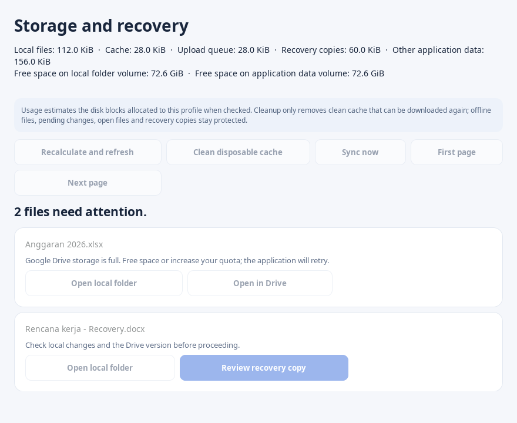

# Storage and recovery

Available from v1.1.0. Open **Storage and recovery** from the dashboard or run `mygdrive-desktop --state /path/to/profile --maintenance`.

## Disk usage

The panel measures allocated disk blocks for the current profile, grouped into local backing files, immutable cache, upload snapshots, recovery copies and other profile data. Sparse files use their allocated size and hardlinked inodes count once. Reflink/shared extents can still be counted by each file; this is an estimate rather than an exact physical-volume total. Free space is displayed separately for the local folder and application-data volume; these may be the same filesystem and must not be added together.

Measurements run outside the GTK thread, never read file contents and do not follow symlinks. Paths that disappear, cannot be inspected or are unsupported are reported as skipped. A live sync can change the result during measurement. **Recalculate and refresh** explicitly measures again; navigating issue pages reuses the previous measurement.

**Clean disposable cache** requests pruning through the current profile's single-writer service. It removes eligible complete cache objects down to a zero-byte target, while existing policy protects offline pins, dirty/review files, active operations and recovery. It can reclaim zero bytes when everything is protected. The cleanup result reports removed cache file lengths; allocated/free disk measurements can differ because of filesystem block allocation. It does not remove every local backing copy, unpin files, change a persistent cache budget or delete cloud files. To release clean backing copies, use the existing offline unpin flow and allow its successful online sync cycle to complete.

Recovery `.swap`/`.removed` history is included in the size but retained. Automatically expiring those inodes would require additional coordination with editors and recovery journals; this version deliberately provides no bulk recovery-history deletion.

## File issues and recovery decisions

The list reads a consistent SQLite WAL snapshot and shows at most 25 rows per page. Review-required states, per-file metadata errors and active operations with recorded failures appear with sanitized explanations. **Open local folder** validates the path without downloading content. **Open in Drive** appears for supported remote IDs. The list remains readable when the service is stopped; maintenance actions need a running service.

**Sync now** asks the existing scheduler to retry reconciliation immediately. It stays unavailable while the service is paused; the panel never resumes synchronization implicitly. Refresh the list to observe the latest file results.

For a `recovery_review` copy, inspect the file in its local folder, then choose **Review recovery copy** and approve in the dialog. Approval allows that copy to sync; it does not select it over an existing remote original or approve arbitrary metadata/delete conflicts. The service re-scans and checks the displayed file generation and SHA-256. A changed/moved copy requires a fresh list and review. Paused services retain the approved local change without starting upload until resumed.

Approval and its request receipt commit in one transaction. Retrying the same request ID returns its original outcome, including after restart, without clearing a newer review. A request ID cannot be reused with a different payload or another recorded offline intent. Commands require the current service session and same-user Unix IPC. A service left running from an older installation must be stopped normally and restarted with the upgraded binary before these actions are available.

## Thunar profiles

Run the existing `install-thunar-actions.py` command for each profile after upgrading. It preserves unrelated custom actions, backs up `uca.xml`, registers the profile in `Thunar/mygdrive-profiles.json` under the selected config directory and migrates an older fixed-profile action when found. Registry mode is private and same-user metadata is validated. Concurrent installer processes use a shared lock.

The two managed actions select the profile by the chosen path's backing root or configured mount. Selections spanning profiles are grouped; unknown, ambiguous or traversal paths are rejected before dispatch. The Rust client then validates each profile's complete group before applying its rules. Groups across accounts are separate operations, not one atomic cross-account transaction. Legacy direct `thunar-action.py --binary ... --state ... --mount ...` calls remain supported.

Unpin queues eligible clean-copy removal during a successful online cycle. Dirty files, open files, other effective pins and recovery stay protected. Installing the source changes does not modify the user's existing Thunar configuration automatically.

## Verification

Regression coverage includes allocated/sparse usage, hardlink deduplication, symlink/traversal rejection, paginated read-only browsing, stale recovery decisions, durable replay after restart, session/payload validation, paused approval, pinned-cache protection, multi-profile routing, legacy migration, concurrent installation and hostile file-name arguments.

`scripts/capture-previews.py --maintenance-only --gtk-only --output-dir /path/to/output` creates an isolated GTK preview using synthetic recovery/quota rows and a read-only mock service. It does not access user OAuth or real Drive files.

Transfer resume, incremental metadata/scanning, automatic recovery retention, a unified multi-account supervisor and Shared Drives remain separate upgrades. No Drive data or existing profile services are changed by building/testing this version.
